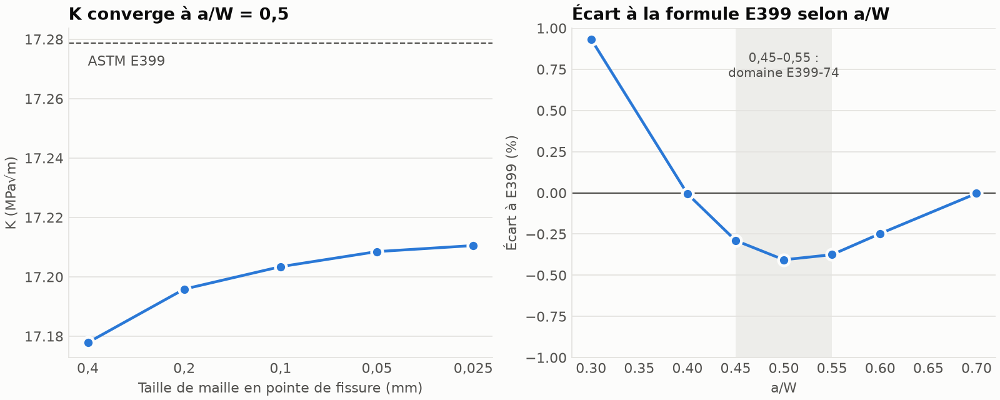
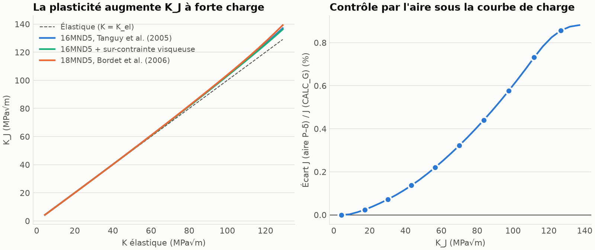
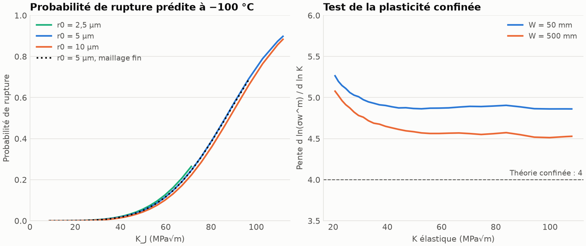
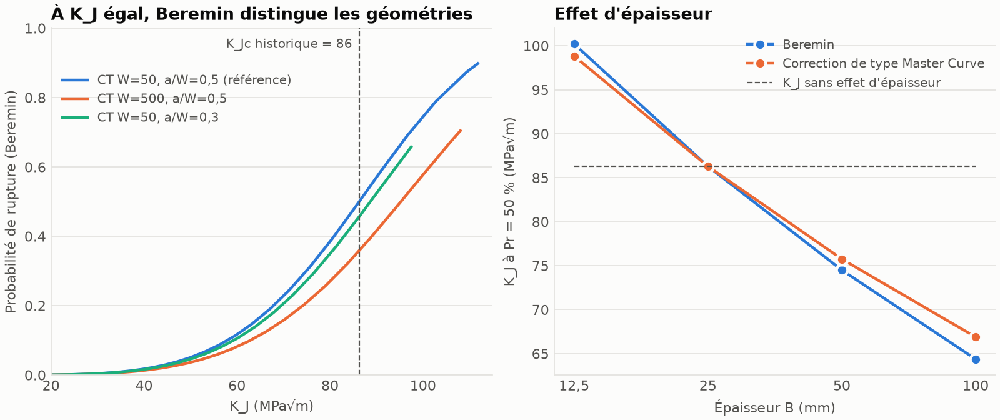

# Éprouvette CT : de K_J au modèle de Beremin avec Code_Aster

Projet personnel en cours. Objectif : calculer le comportement à rupture d'une éprouvette CT par
éléments finis, puis comparer l'approche historique (K, J) au modèle de Beremin (contrainte de Weibull).

| Étape | Contenu | État |
|---|---|---|
| 1 | Calcul élastique, K et G comparés à ASTM E399 | **Fait** |
| 2 | Loi élastoplastique de l'acier 16MND5, calcul de J puis K_J | **Fait** |
| 3 | Pointe émoussée, grandes déformations, contrainte de Weibull et probabilité de rupture en Python | **Fait** |
| 4 | Comparaison K_J / Beremin selon la géométrie, la loi d'écrouissage et l'épaisseur | **Fait** |

## Étape 1 : vérification élastique

Demi-éprouvette en déformations planes, éléments TRIA6 (Gmsh), Code_Aster 17.4.0.
W = 50 mm, E = 200 GPa, ν = 0,3, P/B = 400 N/mm (P = 10 kN, B = 25 mm).
Symétrie sur le ligament, effort vertical uniforme sur le demi-trou supérieur.



| Contrôle | Résultat |
|---|---|
| Équilibre : réaction sur le ligament / effort appliqué | 399,99 / 400 N/mm |
| Écart à E399 pour 0,45 ≤ a/W ≤ 0,55 (h = 0,05 mm) | −0,29 à −0,41 % |
| Écart à E399 pour a/W = 0,3 | +0,93 % |
| Convergence en maillage à a/W = 0,5 (h de 0,05 à 0,025 mm) | variation de K de 0,011 % |
| Indépendance de G au contour d'intégration | dispersion ≤ 0,0002 % (h = 0,05 mm) |
| K1 direct (`CALC_G`) contre K déduit de G (Irwin) | −0,017 % (h = 0,05 mm) |
| Répartition de l'effort : arc uniforme contre force ponctuelle | K varie de 0,01 % |
| G de `CALC_G` contre G énergétique 2 dU/da, da ≤ 0,5 mm | écarts de 0,01 à 0,21 % |

### Lecture des résultats

- **Écart de −0,4 % à a/W = 0,5 :** il ne vient ni du maillage ni de la répartition de l'effort, qui
  pèsent chacun environ 0,01 %. Sa cause n'est pas établie : la formule E399 est un ajustement, et ce
  modèle idéalise l'entaille par une fissure d'épaisseur nulle.
- **Écart de +0,93 % à a/W = 0,3 :** Srawley (1976) signale qu'aux faibles a/W, K devient sensible à la
  proximité des trous de goupille. Le lien avec cet écart reste une hypothèse.
- **Contrôle énergétique :** c'est le contrôle le moins précis. La différence centrée en da et le
  remaillage de chaque longueur de fissure limitent sa précision, et il ne converge pas de façon
  monotone quand da diminue (`results/etape1/controle_energie.csv`). À da = 1 mm, l'écart de +0,33 % est
  du même ordre que l'erreur de troncature estimée (environ 0,35 %).

### Limites

Modèle 2D, élastique linéaire, sans contact goupille-trou, sans éléments quart-de-point en pointe.
Cette étape vérifie la chaîne de calcul : elle ne dit encore rien sur la rupture d'un acier réel.

## Étape 2 : J et K_J élastoplastiques

Même demi-éprouvette, à −100 °C, en petites déformations, avec une plasticité de Von Mises à écrouissage
isotrope (`VMIS_ISOT_TRAC`). Effort imposé par pas de 100 N/mm jusqu'à P/B = 3000 N/mm, soit environ 85 % de
la charge limite estimée. La provenance de chaque paramètre et les valeurs lues sur des courbes sont
détaillées dans [`docs/donnees_materiau.md`](docs/donnees_materiau.md).



| P/B (N/mm) | K élastique (MPa√m) | K_J (MPa√m) | K_J / K élastique | Rayon plastique mesuré (mm) | Écart J aire P–δ / `CALC_G` |
|---|---|---|---|---|---|
| 1000 | 43,0 | 43,3 | +0,7 % | 0,75 | +0,14 % |
| 1500 | 64,5 | 65,5 | +1,5 % | 1,5 | +0,29 % |
| 2000 | 86,0 | 88,2 | +2,5 % | 2,75 | +0,48 % |
| 2500 | 107,6 | 111,8 | +3,9 % | 3,75 | +0,73 % |
| 3000 | 129,1 | 137,0 | +6,2 % | 5,25 | +0,88 % |

Loi 16MND5 de référence, h = 0,05 mm, J pris sur la couronne de 8 à 16 mm. Le rayon plastique est mesuré par
couronnes de 0,25 mm.

| Contrôle ou sensibilité à P/B = 3000 N/mm | Résultat |
|---|---|
| Maillage en pointe (h de 0,1 à 0,025 mm) | K_J de 136,96 à 137,10 MPa√m (0,10 %) |
| Éléments : TRIA6 contre QUAD8 à intégration réduite | K_J de 137,04 contre 137,07 MPa√m (0,02 %) |
| J sur les couronnes 4–8 et 8–16 mm | Écart inférieur à 0,01 % |
| J sur la couronne 0,5–1 mm, dans la zone plastique | 5,4 % plus faible |
| Rayon plastique mesuré / estimation (K/σy)²/(3π) | 5,25 / 5,6 mm |
| Sur-contrainte visqueuse de 22 MPa | K_J de −0,6 % |
| Loi d'un autre acier (18MND5) | K_J de +1,6 % |

### Lecture des résultats

- **K_J dépasse peu K élastique** tant que la plasticité reste confinée à la pointe. L'écart n'atteint 6 %
  qu'à pleine charge, quand la face arrière a déjà commencé à plastifier (à partir de P/B ≈ 2600 N/mm).
- **J dépend du contour à l'intérieur de la zone plastique.** Ce résultat est attendu avec une plasticité
  incrémentale, et il faut donc lire J sur un contour qui englobe cette zone.
- **K_J est peu sensible à la loi d'écrouissage** : 1,6 % d'écart seulement avec la loi d'un autre acier.
  K_J ne permet donc pas de distinguer finement deux lois, et cette faible sensibilité ne garantit rien sur les
  contraintes locales qui pilotent le modèle de Beremin.

### Limites

- **Pas de validation expérimentale :** le calcul est vérifié, mais il n'a été confronté à aucune courbe d'essai.
- **Loi de référence :** R0, Q1 et b1 sont lus sur une figure, et la viscosité n'est prise en compte que par une
  sur-contrainte constante.
- **Modèle :** 2D en déformations planes, petites déformations, fissure vive et stationnaire, sans contact
  goupille-trou ni déchirure ductile.
- **Contraintes en pointe :** le pic de contrainte d'ouverture ne converge pas avec le maillage sur une fissure
  vive (de 2333 à 2735 MPa quand h passe de 0,1 à 0,025 mm). Ce modèle ne convient donc pas pour la contrainte de
  Weibull : l'étape 3 demande une pointe émoussée et des grandes déformations.
- **Formules à vérifier :** le facteur η_pl = 2 + 0,522 b0/W (ASTM E1820) et la charge limite
  P0 = 1,455 α b σ0 (Kumar, German et Shih, 1981) ont été écrits de mémoire. Je n'ai pas pu les vérifier dans les
  textes originaux. L'accord avec `CALC_G` est encourageant, mais il ne constitue pas cette vérification.

## Étape 3 : modèle de Beremin

Calcul en grandes déformations (`GDEF_LOG`, éléments mixtes `D_PLAN_INCO_UPG`) sur une pointe émoussée de rayon
r0, à −100 °C, avec la loi de référence de l'étape 2. La probabilité de rupture suit Tanguy et al. (2005) :

- σw^m = (B/V0) ∫ [σ1 exp(−p/k)]^m dV, sur la zone plastique, en gardant le maximum historique
- Pr = 1 − exp(−(σw/σu)^m)
- m = 17,8 ; σu = 2925 MPa ; V0 = 0,001 mm³ ; k = 4 ; pc = 10⁻⁴ ; épaisseur B = 25 mm

Le post-traitement (`scripts/beremin.py`) est écrit en Python et testé sur des cas analytiques.



| Probabilité de rupture | K_J, ce calcul (r0 = 5 µm) | K_J, modèle de Tanguy et al. (figure 31b, lue en pixels) | Écart |
|---|---|---|---|
| 5 % | 49,9 MPa√m | Non lu | |
| 10 % | 58,0 MPa√m | 55 MPa√m | +5 % |
| 50 % | 86,3 MPa√m | 83,5 MPa√m | +3 % |
| 90 % | ≈ 112 MPa√m (Pr = 0,898 à la charge maximale) | 110 MPa√m | +2 % |

Cette comparaison oppose **deux modèles** qui partagent m, V0 et σu : elle ne remplace pas une comparaison à des
essais. La figure de Tanguy et al. ne contient aucun point expérimental à −100 °C.

### Contrôles

| Contrôle | Résultat |
|---|---|
| Module Python / `POST_BEREMIN` de Code_Aster (sans correction en p) | Écart maximal de 0,003 % |
| Variables internes V3 à V6 / `SIEF_ELGA` | Rapport de V6/SIXY proche de 1 : pas de facteur √2 sur le cisaillement |
| Maillage, à r0 = 5 µm : K_J à Pr = 5 % et 50 % | 49,86 / 49,86 et 86,29 / 86,48 MPa√m (0,2 % au plus) |
| Rayon r0 = 2,5 / 5 / 10 µm : K_J à Pr = 5 % | 48,6 / 49,9 / 51,5 MPa√m |
| Rayon r0 = 5 / 10 µm : K_J à Pr = 50 % | 86,3 / 88,1 MPa√m |
| J par l'aire P–δ, en grandes déformations / K_J de l'étape 2 | Écart de K_J inférieur à 0,4 % |

Le résultat dépend donc encore un peu de r0, et cet effet n'est pas convergé : un rayon plus petit abaisse K_J de
quelques pourcents. En dessous de K_J ≈ 40 MPa√m, l'ouverture de fissure n'est pas grande devant r0 et les valeurs
de Pr dépendent nettement de r0.

### Test ouvert : la pente de σw^m

En plasticité confinée, la théorie prédit σw^m ∝ K⁴ (Pineau et Tanguy, 2010, équation 4). **Ce calcul ne retrouve
pas cette pente exactement** : elle vaut environ 4,86 à W = 50 mm et 4,55 à W = 500 mm, aux mêmes K et sans
correction en p (`results/etape3/test_plasticite_confinee.csv`). La plus grande éprouvette rapproche bien la pente
de 4, ce qui montre que l'effet de taille joue. Il n'explique toutefois qu'environ un tiers de l'écart. Le rayon r0
pourrait expliquer une autre partie, car la pente diminue avec r0 à W = 50 mm, mais je n'ai pas testé ce point à
W = 500 mm. **La cause du reste n'est pas établie.**

### Sensibilités (r0 = 5 µm, un paramètre à la fois)

| Variante | K_J à Pr = 5 % (MPa√m) | K_J à Pr = 50 % (MPa√m) |
|---|---|---|
| Référence | 49,9 | 86,3 |
| Sans correction exp(−p/k) | 49,6 | 85,8 |
| pc = 0 | 49,8 | 86,2 |
| m = 16 / m = 20 | 40,1 / 63,7 | 70,2 / 109,5 |
| σu −5 % / σu +5 % | 41,2 / 59,8 | 71,1 / 104,1 |
| Épaisseur 12,5 mm / 50 mm | 57,6 / 43,2 | 100,2 / 74,5 |

Le modèle est très sensible à m et σu : 5 % sur σu déplacent K_J à 50 % d'environ 20 %. Ces variations isolées
majorent l'incertitude réelle, car m et σu sont identifiés ensemble et ne varient pas indépendamment.

### Limites

- **Pas de validation expérimentale :** aucune ténacité mesurée à −100 °C n'a été comparée à ces résultats.
- **Paramètres empruntés :** m, σu et V0 ont été identifiés par Tanguy et al. sur des barreaux entaillés, avec un
  autre code de calcul et un autre maillage. La figure 31a de leur article justifie un σu constant jusque vers −80 °C.
- **Lissage :** leur lissage de la trace du tenseur n'est pas repris. La formulation mixte traite ici la pression.
- **Contrainte utilisée :** la contrainte de Kirchhoff (écart de l'ordre de 1 % avec Cauchy), intégrée sur la
  configuration initiale, comme le fait `POST_BEREMIN`.
- **Modèle :** 2D en déformations planes : tout le front de fissure subit le même état, sans effet de bord. Pas de
  déchirure ductile, ni de viscosité.
- **Charge maximale :** r0 = 2,5 µm s'arrête à P/B = 1629 N/mm (K_J = 71 MPa√m) et le maillage fin à 2181 N/mm
  (K_J = 97 MPa√m), par échec d'intégration en pointe. Les pas convergés restent exploités.
- **K_J :** il est repris de l'étape 2 (fissure vive, petites déformations), et le contrôle énergétique le confirme.

## Étape 4 : comparaison de K_J et du modèle de Beremin

L'approche historique compare K_J à une ténacité K_Jc supposée propre au matériau : deux géométries au même K_J
présentent alors le même risque. Pour les comparer, K_Jc est pris égal au K_J à Pr = 50 % du cas de référence
(86,3 MPa√m). Ce n'est pas une ténacité mesurée. Chaque cas reprend r0 = 5 µm et les paramètres de l'étape 3, et
K_J vient d'un calcul `CALC_G` propre à chaque géométrie.



### Géométrie : même épaisseur (25 mm), même K_J

| Géométrie | K_J à Pr = 10 % | K_J à Pr = 50 % | Pr au K_Jc de l'approche historique |
|---|---|---|---|
| W = 50 mm, a/W = 0,5 (référence) | 58,0 | 86,3 | 50 % |
| W = 50 mm, a/W = 0,3 | 59,3 | 88,7 (+3 %) | 46 % |
| W = 500 mm, a/W = 0,5 | 62,9 | 95,3 (+10 %) | 36 % |

K_J en MPa√m. L'approche historique ne distingue pas ces trois cas. Beremin prédit un risque plus élevé pour la
petite éprouvette à a/W = 0,5, ce qui va dans le sens attendu d'une contrainte T positive plus forte à même K. Je
n'ai pas calculé T : cette explication reste à vérifier.

### Loi d'écrouissage : m, σu et V0 inchangés

| Loi | K_J à P/B = 2500 N/mm | K_J à Pr = 50 % |
|---|---|---|
| 16MND5, Tanguy et al. (référence) | 111,8 | 86,3 |
| 16MND5 + sur-contrainte de 22 MPa | 111,5 (−0,3 %) | 77,9 (−9,7 %) |
| 18MND5, Bordet et al. | 112,5 (+0,6 %) | 99,1 (+14,9 %) |

**C'est l'écart le plus net entre les deux approches :** le changement de loi modifie K_J de moins de 1 %, mais le
K_J à 50 % de Beremin de 10 à 15 %. Cet écart est un majorant : en pratique, m et σu sont identifiés avec la loi
utilisée, ce qui compense en partie son effet.

### Épaisseur

| B (mm) | Beremin | Correction de type Master Curve | Approche historique sans effet de B |
|---|---|---|---|
| 12,5 | 100,2 | 98,8 | 86,3 |
| 25 | 86,3 | 86,3 | 86,3 |
| 50 | 74,5 | 75,7 | 86,3 |
| 100 | 64,4 | 66,9 | 86,3 |

K_J à Pr = 50 %, en MPa√m. Beremin reproduit un effet d'épaisseur proche de la correction empirique
K = 20 + (K₀ − 20)(B₀/B)^(1/4), écrite de mémoire d'après ASTM E1921 et à vérifier. Cet effet est calculé par simple
proportionnalité à B en 2D : il ne tient pas compte de l'état de contrainte réel près des bords de l'éprouvette.

### Synthèse

| Question | K_J (approche historique) | Beremin |
|---|---|---|
| Résultat | Une valeur, à comparer à un seuil | Une probabilité de rupture |
| Effet de la géométrie à K_J égal | Aucun | K_J à 50 % de +3 à +10 % ici |
| Effet de l'épaisseur | Aucun sans correction ajoutée | Inclus dans le modèle |
| Sensibilité à la loi d'écrouissage | Moins de 1 % ici | 10 à 15 % à paramètres fixes |
| Sensibilité au maillage | 0,1 % avec une fissure vive | 0,2 %, avec une pointe émoussée obligatoire |
| Paramètres à identifier | Une ténacité mesurée, sur le matériau | m, σu, V0, à recaler avec la loi |

Ce modèle donne donc plus d'informations que K_J, mais il est plus sensible à ses données d'entrée. Ces résultats
portent sur quelques éprouvettes CT : ils ne suffisent pas à conclure sur le choix d'une méthode pour une structure.

### Limites

- **Pas de composant de cuve :** seule l'éprouvette CT a été traitée.
- **Pas de validation expérimentale :** aucune des différences entre géométries n'a été comparée à des essais.
- **Charge maximale :** le cas a/W = 0,3 s'arrête à P/B = 3747 N/mm (K_J = 97 MPa√m), par échec d'intégration en
  pointe, et le cas W = 500 mm à K_J = 108 MPa√m. Le niveau de 90 % n'est donc pas comparé entre géométries.
- **Formule E399 à a/W = 0,3 :** l'étape 1 y trouve +0,93 %, mais les K_J comparés ici viennent de `CALC_G`.
- **Limites des étapes précédentes :** 2D, r0 = 5 µm, paramètres empruntés, et la pente de σw^m non expliquée.

## Reproduire

Prérequis : Docker, Gmsh et Python 3. L'image `simvia/code_aster:17.4.0` pèse environ 7 Go sur disque.

```bash
python3 -m venv .venv
.venv/bin/pip install -r requirements.txt
.venv/bin/python -m pytest -q tests
.venv/bin/python scripts/run_etape1.py    # environ 7 minutes
.venv/bin/python scripts/plot_etape1.py
.venv/bin/python scripts/run_etape2.py    # environ 25 minutes
.venv/bin/python scripts/plot_etape2.py
.venv/bin/python scripts/run_etape3.py                # environ 30 minutes
.venv/bin/python scripts/run_etape3.py W500_r0_5um    # environ 15 minutes
.venv/bin/python scripts/analyse_etape3.py
.venv/bin/python scripts/plot_etape3.py
.venv/bin/python scripts/run_etape4.py                # environ 40 minutes
.venv/bin/python scripts/analyse_etape4.py
.venv/bin/python scripts/plot_etape4.py
```

## Références

Les sources des données matériau sont listées dans [`docs/donnees_materiau.md`](docs/donnees_materiau.md).

- J. E. Srawley, *Wide range stress intensity factor expressions for ASTM E 399 standard fracture
  toughness specimens*, NASA TM X-71881, 1976.
- ASTM E399, *Standard Test Method for Linear-Elastic Plane-Strain Fracture Toughness of Metallic Materials*.
